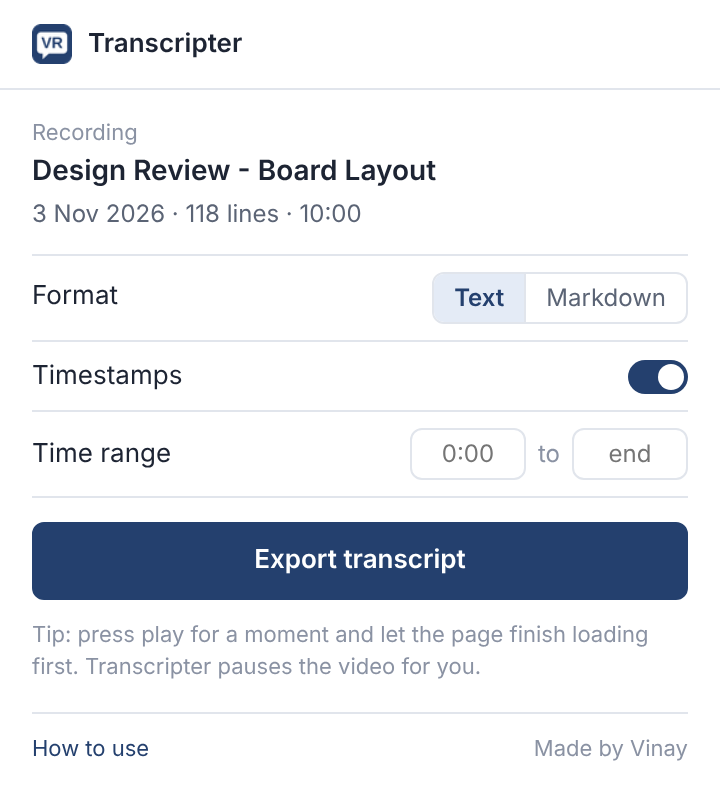
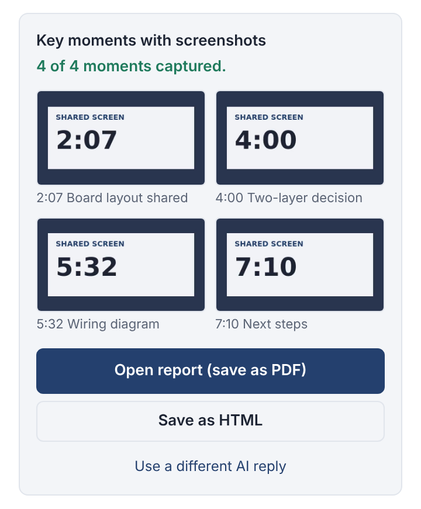

# Transcripter

Save the complete transcript of a Microsoft Teams or Stream meeting recording, with speaker names and timestamps, as a Text or Markdown file. Then let an AI pick the key moments and get a report with a screenshot from the recording at each one. It all happens in a side panel, entirely in your browser.

**Video walkthrough:** [How to install and use Transcripter](https://youtu.be/Ivvc7ZI2MMw)

## Why

The Transcript panel on a recording only shows a few lines at a time, and the Download option isn't always available. Copying a long meeting by hand means scrolling and copying dozens of times. Transcripter scrolls the panel for you, collects every line, checks nothing is missing, and saves one tidy file.

## Features

- Saves the whole transcript, not just the lines on screen
- Keeps speaker names and timestamps (or leave timestamps out)
- Text (`.txt`) or Markdown (`.md`) output
- **Time range:** save just a section, e.g. `12:00` to `20:00`
- **Stop and save:** stop part-way and keep everything collected so far
- Counts every line and reports any that are missing
- Keeps the video paused while it works, and recovers if the panel jumps
- **Key moments report:** copy a ready-made AI prompt, paste the AI's reply back, and Transcripter captures a frame from the recording at each moment. You get a report with each screenshot, the reason, and the surrounding transcript, saved as PDF or HTML
- Opens in a **side panel** that stays open while you work, and follows the tab you're on
- Runs entirely in your browser; nothing is sent anywhere

  
  

## Install

Works in Chromium browsers: Chrome, Edge, Brave, Opera and Vivaldi.

1. Download this repository (**Code → Download ZIP**, or the zip from the latest [Release](../../releases)) and extract it somewhere permanent.
2. Open your browser's extensions page:

   | Browser | Address |
   |---|---|
   | Chrome | `chrome://extensions` |
   | Edge | `edge://extensions` |
   | Brave | `brave://extensions` |
   | Opera | `opera://extensions` |
   | Vivaldi | `vivaldi://extensions` |

3. Turn on **Developer mode** (top-right; in Edge it's in the left sidebar).
4. Click **Load unpacked** and choose the `transcripter` folder, the one containing `manifest.json`.
5. Pin Transcripter from the puzzle-piece menu (in Edge, click the eye icon). Clicking the VR icon opens it in the side panel (in Opera and Vivaldi, as a popup).

For a step-by-step guide with pictures, open [`START HERE.html`](START%20HERE.html) in your browser after downloading.

## Use

1. Open the meeting recording **in your browser** and open its **Transcript** panel.
2. Tip: press play for a moment and let the page finish loading. Transcripter pauses the video for you.
3. Click the **VR** icon, choose your options, and click **Export transcript**.
4. The file lands in your Downloads, named after the meeting and its date.

The export keeps going even if you close the panel; keep the tab open.

### Key moments with screenshots

1. After an export, click **Copy AI prompt** and paste it into your AI assistant.
2. Paste the AI's reply into the panel. It expects one moment per line, like `12:34 | Title | Why it matters`, and copes with numbered lists and bullets.
3. Click **Capture screenshots**. The video jumps to each moment and the frame is captured; keep the recording tab in front.
4. Click **Open report**, then **Save as PDF**, or **Save as HTML** for a single shareable file.

## Update

Replace the contents of your `transcripter` folder with the new version, then click the reload button on Transcripter's card on the extensions page.

## Privacy and permissions

Transcripter only works on `*.sharepoint.com` pages, where recordings are played. Its permissions are `scripting` and access to `sharepoint.com` (to read the transcript and video on the page, even as the side panel follows you between recordings), `activeTab` (to capture the visible tab when a recording's video frames are protected), `sidePanel`, and `storage` (to hold the latest report locally until you save it). It makes no network requests of its own and collects no data. The AI prompt goes to your clipboard; you choose where to paste it.

Please follow your organisation's rules when sharing meeting content.

## Limitations

Transcripter reads the transcript panel's page structure. If Microsoft changes that layout, an update may be needed; please [open an issue](../../issues).

## Disclaimer

Transcripter is an independent project and is not affiliated with or endorsed by Microsoft. Microsoft Teams and Microsoft Stream are trademarks of Microsoft.

Made by Vinay. Released under the [MIT License](LICENSE).
