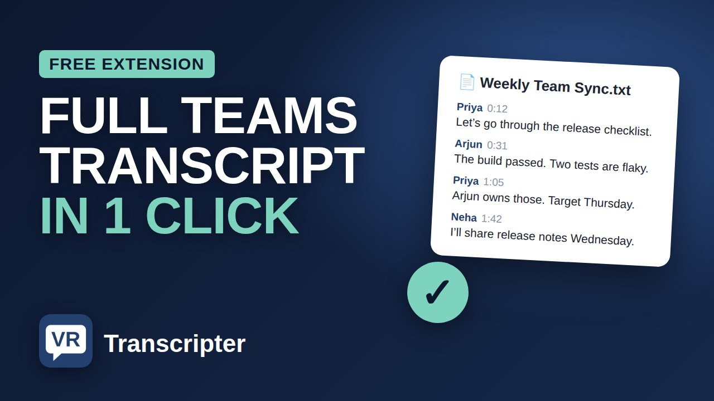
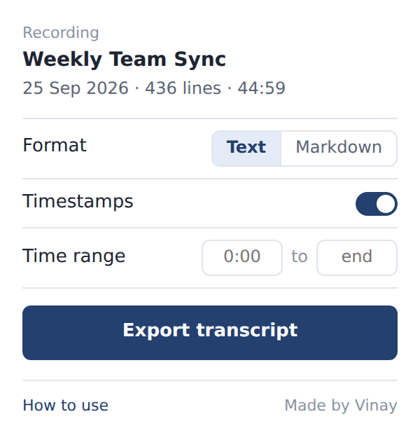
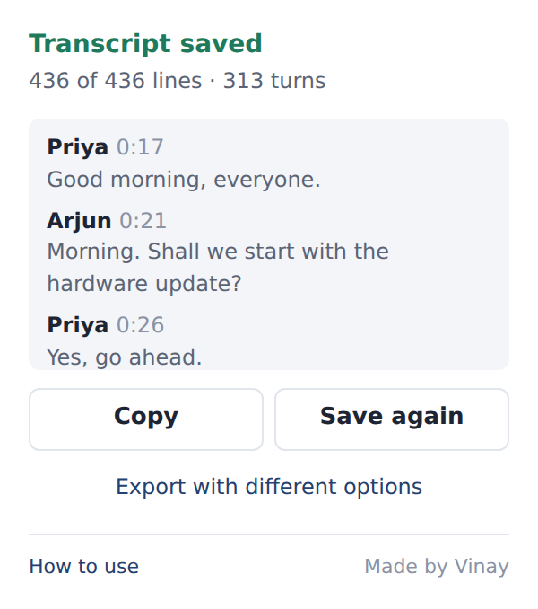

# Transcripter

Save the complete transcript of a Microsoft Teams or Stream meeting recording, with speaker names and timestamps, as a Text or Markdown file. One click, entirely in your browser.

**Video walkthrough:** [How to install and use Transcripter](https://youtu.be/Ivvc7ZI2MMw)

## Why

The Transcript panel on a recording only shows a few lines at a time, and the Download option isn't always available. Copying a long meeting by hand means scrolling and copying dozens of times. Transcripter scrolls the panel for you, collects every line, checks nothing is missing, and saves one tidy file.

## Features

- Saves the whole transcript, not just the lines on screen
- Keeps speaker names and timestamps (or leave timestamps out)
- Text (`.txt`) or Markdown (`.md`) output
- **Time range:** save just a section, e.g. `12:00` to `20:00`
- **Stop and save:** stop part-way and keep everything collected so far
- Counts every line and reports any that are missing
- Keeps the video paused while it works, and recovers if the panel jumps
- Runs entirely in your browser; nothing is sent anywhere

  
  

## Install

Works in Chromium browsers: Chrome, Edge, Brave, Opera and Vivaldi.

1. Download this repository (**Code → Download ZIP**, or the zip from the latest [Release](../../releases)) and extract it somewhere permanent.
2. Open your browser's extensions page:

   | Browser | Address |
   |---|---|
   | Chrome | `chrome://extensions` |
   | Edge | `edge://extensions` |
   | Brave | `brave://extensions` |
   | Opera | `opera://extensions` |
   | Vivaldi | `vivaldi://extensions` |

3. Turn on **Developer mode** (top-right; in Edge it's in the left sidebar).
4. Click **Load unpacked** and choose the `transcripter` folder, the one containing `manifest.json`.
5. Pin Transcripter from the puzzle-piece menu (in Edge, click the eye icon).

For a step-by-step guide with pictures, open [`START HERE.html`](START%20HERE.html) in your browser after downloading.

## Use

1. Open the meeting recording **in your browser** and open its **Transcript** panel.
2. Tip: press play for a moment and let the page finish loading. Transcripter pauses the video for you.
3. Click the **VR** icon, choose your options, and click **Export transcript**.
4. The file lands in your Downloads, named after the meeting and its date.

You can close the popup while it runs; keep the tab open.

## Update

Replace the contents of your `transcripter` folder with the new version, then click the reload button on Transcripter's card on the extensions page.

## Privacy and permissions

Transcripter asks only for `activeTab` and `scripting`, and only runs on `*.sharepoint.com` pages where recordings are played. It reads the transcript already shown on the page and saves it to your computer. It makes no network requests of its own and collects no data.

Please follow your organisation's rules when sharing meeting content.

## Limitations

Transcripter reads the transcript panel's page structure. If Microsoft changes that layout, an update may be needed; please [open an issue](../../issues).

## Disclaimer

Transcripter is an independent project and is not affiliated with or endorsed by Microsoft. Microsoft Teams and Microsoft Stream are trademarks of Microsoft.

Made by Vinay. Released under the [MIT License](LICENSE).
